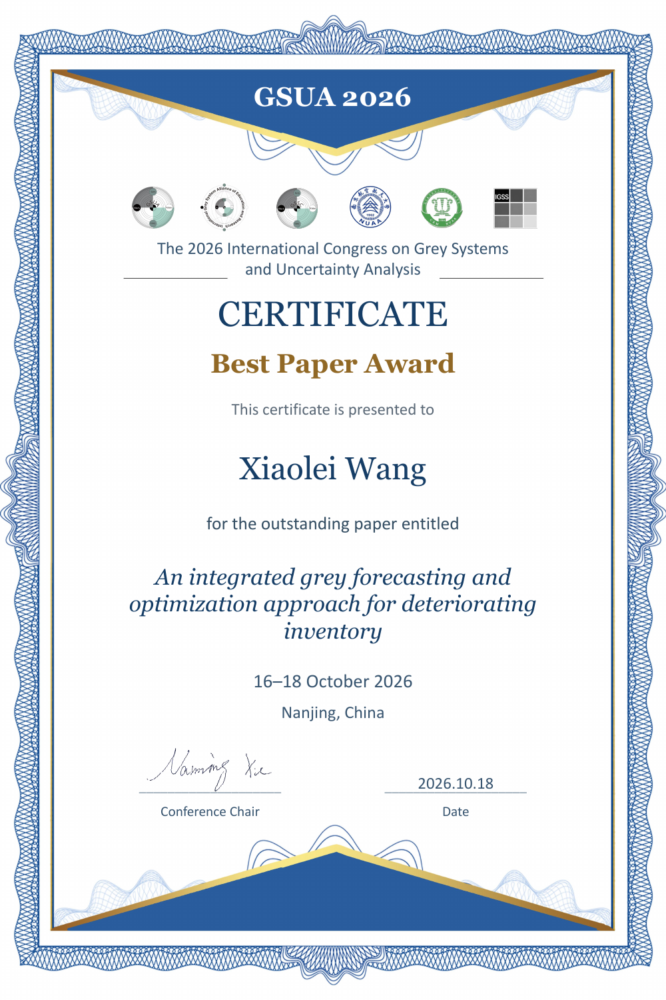

I attended the **2026 International Congress on Grey Systems and Uncertainty Analysis (GSUA 2026)** in **Nanjing, China, on October 16–18, 2026**. The conference was held jointly with the 2026 annual meeting of the Grey Systems Committee of the Chinese Society of Optimization, Overall Planning and Economical Mathematics.

The congress was sponsored by the International Association of Grey Systems and Uncertainty Analysis, with the Grey Systems Committee and the International Grey System Alliance of Education and Research as co-sponsors. It was organized by the Institute for Grey Systems Studies, College of Economics and Management, Nanjing University of Aeronautics and Astronautics.

## Best Paper Award

I received a **Best Paper Award** for my paper, *An integrated grey forecasting and optimization approach for deteriorating inventory*.

[View the award certificate (PDF)](certificate.pdf)

[Conference information (in Chinese)](https://mp.weixin.qq.com/s/c9E4X7wVN-_xzyD5QMoLHA)
